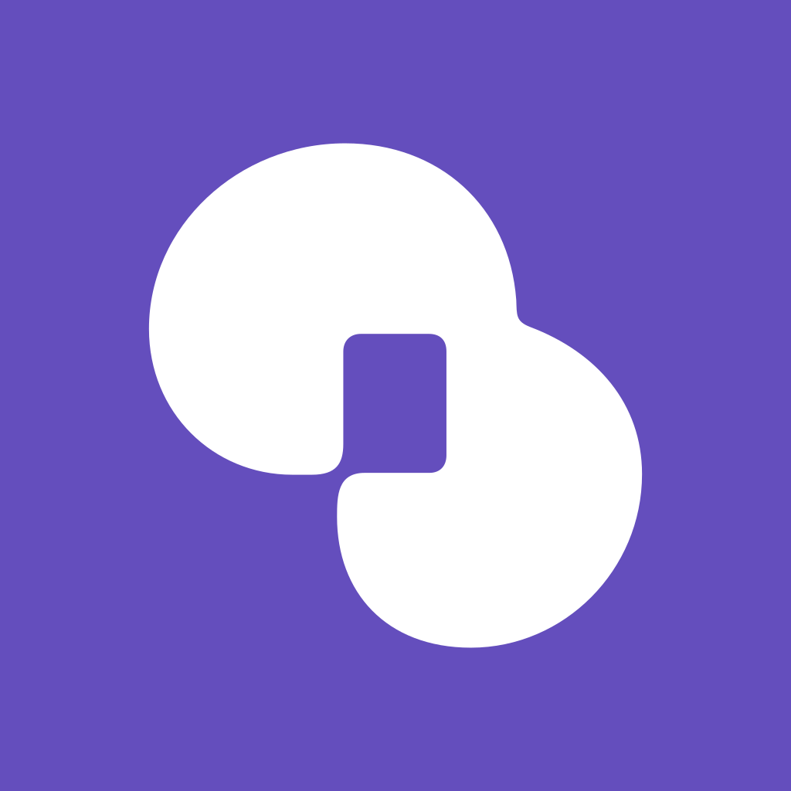

<div align="center">



# RowCat

**인터랙티브 스토리를 위한 오픈소스 플랫폼이에요.**<br>
이야기를 갤러리에 올리고 AI와 대화하며 플레이할 수 있고,<br>
TSX로 직접 짠 작은 프로그램으로 만들어 웹과 모바일에서 돌릴 수도 있어요.

[](https://github.com/Project-RowCat/RowCat/actions/workflows/ci.yml)
[](LICENSE)
[](#라이선스)
[](https://github.com/sponsors/astra-void)

[빠른 시작](#빠른-시작) · [직접 배포 안내](docs/oss/SELF-HOSTING.ko.md) · [크리에이터 런타임 문서](docs/public/runtime/index.md) · [포크하기](docs/oss/FORKING.md) · [English](README.md)

</div>

> [!NOTE]
> RowCat은 호스팅 서비스로 운영되다가 서비스를 종료했어요. 이 저장소에는 그 코드가 전부 들어 있고,
> 누구나 읽고 배우거나 다른 이름으로 직접 배포할 수 있도록 공개했어요. 지금 이 코드로 운영 중인
> 공식 서비스는 없어요.

## 이런 걸 할 수 있어요

- **대화는 내 기기에 남아요.** 대화, 메모리, 이야기 초안은 기기 안의 데이터베이스(웹은 IndexedDB,
  모바일은 SQLite)에 저장되고, 내 기기끼리 종단간 암호화로 동기화돼요. 서버는 열어 볼 수 없는 암호문만
  보관하고, 새 기기는 짧은 코드 하나로 연결할 수 있어요.
- **AI 키는 내 것도, 운영자 것도 쓸 수 있어요.** 내 Anthropic이나 Gemini 키를 연결하면 브라우저나 앱이
  공급자를 바로 호출해요. 운영자는 허용 목록과 요청 한도를 걸어 OpenRouter 기반 관리형 모델을 제공할 수도
  있어요.
- **이야기를 프로그램으로 만들 수 있어요.** 크리에이터 런타임에서는 `@rowcat/runtime`에 맞춰 TSX로 작품을
  짜요. 발행할 때 서버가 컴파일하고, 플레이어 쪽에서는 격리된 QuickJS/WASM 가상 머신 안에서 실행돼요.
  웹에서는 DOM으로, 모바일에서는 네이티브 뷰로 그려져요.
- **둘러보기 좋은 갤러리가 있어요.** 검색, 태그, 관련 작품, 인기순, 즐겨찾기, 답글 달리는 댓글, 팔로우,
  크리에이터 프로필까지 갖췄어요.
- **필요한 앱이 다 들어 있어요.** SSR 웹 앱, 자체 서명 OTA 업데이트를 갖춘 Expo 모바일 앱, 운영 콘솔,
  컴퓨터 한 대에 설치하는 데스크톱 앱, 그리고 코딩 에이전트가 런타임 작품을 쓸 수 있게 해 주는 MCP 서버가
  있어요.
- **눈에 잘 안 띄는 부분도 챙겼어요.** 패스키, 2단계 인증, Google·Apple·카카오 로그인, 이의 제기까지 되는
  모더레이션, 푸시 알림, 법정대리인 동의와 연령 확인이 들어 있어요.

## TSX 몇 줄로 만드는 이야기

```tsx
import { Button, Screen, Stack, Text, color, defineStoryState, useStoryState } from "@rowcat/runtime";

const game = defineStoryState({ key: "game", version: 1, initial: { chapter: 1 } });

export default function App() {
	const [state, setState] = useStoryState(game);

	return (
		<Screen background={color("#0b0d12")}>
			<Stack gap={12} style={{ padding: 24 }}>
				<Text style={{ color: color("#f5f7fa"), fontSize: 22 }}>{state.chapter}장</Text>
				<Button onPress={() => setState((s) => ({ chapter: s.chapter + 1 }))}>계속</Button>
			</Stack>
		</Screen>
	);
}
```

`useStoryState`로 만든 상태는 앱을 껐다 켜도 남아 있고, 기기끼리 동기화되며, 웹과 모바일에서 똑같이
동작해요. 컴포넌트, 상태, AI 생성, 발행은 [크리에이터 런타임 문서](docs/public/runtime/index.md)에서
자세히 볼 수 있어요.

## 빠른 시작

Node.js 22 이상, pnpm(`corepack enable`), Docker만 있으면 돼요.

```bash
pnpm install
pnpm dev:setup   # env 파일, 시크릿, Docker Postgres, 스키마, 개발 계정까지 한 번에
pnpm dev:all     # 웹 :3000, API :3001, 운영 콘솔 :3002
```

<http://localhost:3000>을 열고 `dev@rowcat.test` / `rowcat-dev`로 로그인해 보세요. AI 답변을 받으려면 키가
필요해요. `apps/api/.env`에 `OPENROUTER_API_KEY`를 넣거나, AI 설정에서 내 Anthropic 또는 Gemini 키를
연결하면 돼요.

## 직접 배포하기

공개된 이미지에는 배포별 설정값이 들어 있지 않아요. 기본 배포라면 Postgres와 시크릿 하나면 충분해요.

```bash
cp .env.example .env   # BETTER_AUTH_SECRET과 POSTGRES_PASSWORD를 생성하고 오리진을 설정해요
docker compose up -d   # api, web, admin에 Postgres와 Redis까지 함께 떠요
```

첫 관리자 지정, Caddy로 붙이는 HTTPS, 백업과 업그레이드, 데스크톱 설치 파일, 선택 연동은
[직접 배포 안내](docs/oss/SELF-HOSTING.ko.md)에 정리해 뒀어요. 내 이름으로 배포하기 전에는
[FORKING.md](docs/oss/FORKING.md)도 꼭 읽어 주세요. RowCat의 이름과 정체성이 들어 있는 자리를 모두 짚어
줘요.

## 이렇게 만들었어요

strict TypeScript로 쓴 pnpm 모노레포예요.

| | |
| --- | --- |
| **API** | Hono, Better Auth, Postgres 위의 Drizzle — 공개 API는 `/v2` 하나 |
| **웹** | TanStack Start(SSR), React 19, TanStack Router/Query, Tailwind 4 |
| **모바일** | Expo, SQLite, SecureStore, 직접 운영하는 서명된 OTA 서버 |
| **콘솔** | 모더레이션과 배포 설정을 위한 Vite SPA |
| **런타임** | TypeScript 컴파일러 → 아티팩트, QuickJS/WASM 호스트, DOM·React Native 렌더러 |
| **동기화** | AES-256-GCM 봉투 암호화, 복구 코드가 있는 키링, 하이브리드 논리 시계 |

왜 이렇게 설계했는지는 대부분 글로 남아 있어요. [AGENTS.md](AGENTS.md)가 전체 색인이고 어느 패키지가 어느
패키지를 가져다 쓸 수 있는지도 정리해 뒀어요. `docs/`에는 결정 기록이 있고, 각 파일 맨 위 주석에는 그
파일이 지키는 경계가 적혀 있어요.

## 기여하기

기여는 언제든 환영해요. 먼저 [CONTRIBUTING.md](CONTRIBUTING.md)를 읽어 주세요. 커밋에는 DCO 서명이
필요해요. 취약점은 공개 이슈 말고 [SECURITY.md](SECURITY.md)에 적힌 방법으로 비공개 제보해 주세요. 이
프로젝트는 [행동 강령](CODE_OF_CONDUCT.md)을 따라요.

```bash
pnpm check && pnpm typecheck && pnpm test
```

## 라이선스

RowCat은 **GNU Affero General Public License v3.0 only**([LICENSE](LICENSE))로 배포돼요. 다른 곳에서도
가져다 쓰기 좋은 여덟 패키지는 **Apache License 2.0**이고, 각 패키지에 `LICENSE` 파일이 따로 있어요:
`packages/runtime`, `runtime-compiler`, `runtime-host`, `runtime-renderer-web`, `runtime-renderer-native`,
`runtime-persistence`, `runtime-ai-docs`, `contracts`. 함께 들어 있는 서드파티 자산은 [NOTICE](NOTICE)에서
볼 수 있어요.

라이선스는 코드에만 적용되고, 이름과 앱 아이콘은 포함되지 않아요. "RowCat"이라는 이름은 이 프로젝트에
남기 때문에, 포크해서 배포할 때는 자기만의 이름과 정체성을 써 주세요([NOTICE](NOTICE)의 "Trademarks").

## 후원

RowCat이 도움이 되었다면 [GitHub Sponsors](https://github.com/sponsors/astra-void)에서 메인테이너를 후원해
주세요. 큰 힘이 돼요.
