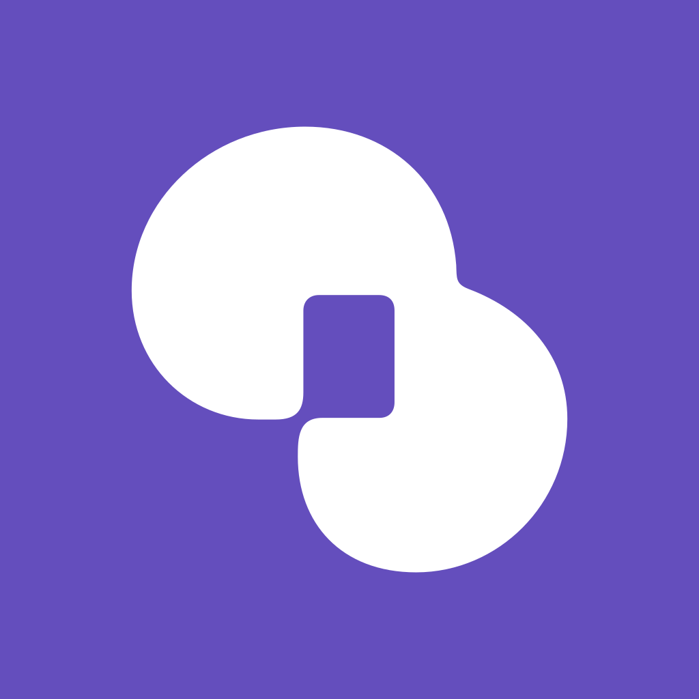

<div align="center">



# RowCat

**An open-source platform for interactive stories.**<br>
Publish a story to a shared gallery and play it as an AI conversation —<br>
or write it as a small TSX program that runs in a sandbox on the web and on mobile.

[](https://github.com/Project-RowCat/RowCat/actions/workflows/ci.yml)
[](LICENSE)
[](#license)
[](https://github.com/sponsors/astra-void)

[Quick start](#quick-start) · [Self-hosting guide](docs/oss/SELF-HOSTING.md) · [Creator runtime docs](docs/public/runtime/index.md) · [Forking](docs/oss/FORKING.md) · [한국어](README.ko.md)

</div>

> [!NOTE]
> RowCat ran as a hosted service, and that service has shut down. This repository is its complete code,
> released so anyone can learn from it or run their own deployment under a different name. No hosted
> instance runs it today.

## Highlights

- **Your conversations stay on your devices.** Conversations, memories and story drafts live in the
  device's own database (IndexedDB on the web, SQLite on mobile) and sync across your devices with
  end-to-end encryption. The server only stores ciphertext it cannot read. You add a new device with a short pairing code.
- **Use your own AI key or the operator's.** Members can connect their own Anthropic or Gemini key, and the browser or app then calls the provider directly. An operator can also offer a managed model through
  OpenRouter, limited by an allowlist and rate limits.
- **Stories can be programs.** With the creator runtime, authors write TSX against `@rowcat/runtime`. The
  server compiles it when the story is published, and players run it inside an isolated QuickJS/WASM
  virtual machine. The web draws it to the DOM and mobile draws it as native views.
- **A gallery built for discovery.** Search, tags, related works, popular rankings, favourites,
  comments with replies, follows and public creator profiles.
- **Every client you need.** The repository includes an SSR web app, an Expo mobile app with its own signed OTA updates, an
  operations console, a one-computer desktop installer, and an MCP server that lets a coding agent write
  runtime stories.
- **The less glamorous essentials are covered too.** Passkeys, two-factor authentication, Google/Apple/Kakao sign-in,
  moderation with appeals, push notifications, guardian consent and age gating.

## A story in a few lines of TSX

```tsx
import { Button, Screen, Stack, Text, color, defineStoryState, useStoryState } from "@rowcat/runtime";

const game = defineStoryState({ key: "game", version: 1, initial: { chapter: 1 } });

export default function App() {
	const [state, setState] = useStoryState(game);

	return (
		<Screen background={color("#0b0d12")}>
			<Stack gap={12} style={{ padding: 24 }}>
				<Text style={{ color: color("#f5f7fa"), fontSize: 22 }}>Chapter {state.chapter}</Text>
				<Button onPress={() => setState((s) => ({ chapter: s.chapter + 1 }))}>Continue</Button>
			</Stack>
		</Screen>
	);
}
```

The `useStoryState` state above persists across sessions, syncs between devices, and runs the same way on web and mobile. The
[creator runtime docs](docs/public/runtime/index.md) cover components, state, AI generation and publishing.
They are written in Korean.

## Quick start

You need Node.js 22+, pnpm (`corepack enable`) and Docker.

```bash
pnpm install
pnpm dev:setup   # env files, a generated secret, Postgres in Docker, schema, a dev account
pnpm dev:all     # web on :3000, API on :3001, operations console on :3002
```

Open <http://localhost:3000> and sign in as `dev@rowcat.test` / `rowcat-dev`. AI replies need a key: either
set `OPENROUTER_API_KEY` in `apps/api/.env`, or connect your own Anthropic or Gemini key under AI settings.

## Self-hosting

The published images contain no deployment-specific values. For a basic deployment, you need Postgres and one secret:

```bash
cp .env.example .env   # generate BETTER_AUTH_SECRET and POSTGRES_PASSWORD; set your origins
docker compose up -d   # api, web and admin, with Postgres and Redis
```

The [self-hosting guide](docs/oss/SELF-HOSTING.md) covers the first administrator, HTTPS with Caddy,
backups and upgrades, the desktop installer, and every optional integration. Before you deploy under your own name,
read [FORKING.md](docs/oss/FORKING.md). It lists every place that carries the RowCat name and identity.

## How it's built

A pnpm monorepo in strict TypeScript.

| | |
| --- | --- |
| **API** | Hono, Better Auth, Drizzle on Postgres — one public API, `/v2` |
| **Web** | TanStack Start (SSR), React 19, TanStack Router/Query, Tailwind 4 |
| **Mobile** | Expo, SQLite, SecureStore, a self-hosted signed OTA server |
| **Console** | Vite SPA for moderation and deployment settings |
| **Runtime** | TypeScript compiler → artifact, a QuickJS/WASM host, DOM and React Native renderers |
| **Sync** | AES-256-GCM envelopes, a keyring with recovery codes, hybrid logical clocks |

Most of the design reasoning is written down. [AGENTS.md](AGENTS.md) indexes it and states which packages
may import which. `docs/` holds the decision records (in Korean). File headers explain the boundaries
each file enforces.

## Contributing

Contributions are welcome. Read [CONTRIBUTING.md](CONTRIBUTING.md) first; commits need a DCO sign-off.
Report vulnerabilities privately as described in [SECURITY.md](SECURITY.md), not in public issues. This
project follows a [Code of Conduct](CODE_OF_CONDUCT.md).

```bash
pnpm check && pnpm typecheck && pnpm test
```

## License

RowCat is licensed under the **GNU Affero General Public License v3.0 only** ([LICENSE](LICENSE)). Eight
reusable packages are licensed under the **Apache License 2.0**, each with its own `LICENSE` file:
`packages/runtime`, `runtime-compiler`, `runtime-host`, `runtime-renderer-web`, `runtime-renderer-native`,
`runtime-persistence`, `runtime-ai-docs` and `contracts`. Third-party assets are listed in
[NOTICE](NOTICE).

The licenses cover the code, not the name or the app icon. "RowCat" stays with this project, so a fork
ships under its own name and identity ([NOTICE](NOTICE), "Trademarks").

## Sponsoring

If RowCat is useful to you, you can support its maintainer on
[GitHub Sponsors](https://github.com/sponsors/astra-void).
